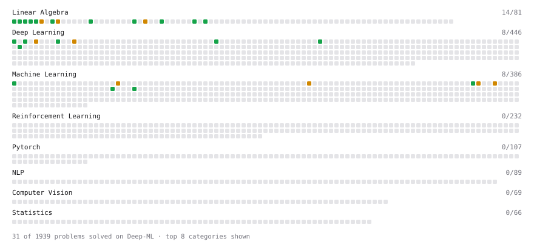

# Deep-ML

My machine learning practice from [Deep-ML](https://www.deep-ml.com). Every solution here was written by hand.

**47** solved · 32 problems · 3 labs · 12 math

[**Browse the interactive portfolio**](https://raghulchandramouli.github.io/deep-ml/) to replay this filling in over time.

## Problems

| | Difficulty | Solved | |
| --- | --- | --- | --- |
| [Calculate 2x2 Matrix Inverse](https://www.deep-ml.com/problems/8) | easy | 2026-05-12 | [solution](problems/0008-calculate-2x2-matrix-inverse) |
| [Calculate Mean by Row or Column](https://www.deep-ml.com/problems/4) | easy | 2026-04-28 | [solution](problems/0004-calculate-mean-by-row-or-column) |
| [Calculate Number of Parameters in Neural Network](https://www.deep-ml.com/problems/371) | easy | 2026-05-19 | [solution](problems/0371-calculate-number-of-parameters-in-neural-network) |
| [Compute Multi-class Cross-Entropy Loss](https://www.deep-ml.com/problems/134) | easy | 2026-05-21 | [solution](problems/0134-compute-multi-class-cross-entropy-loss) |
| [Compute TTFT ITL and TPS from a Token Timestamp Stream](https://www.deep-ml.com/problems/411) | easy | 2026-10-12 | [solution](problems/0411-compute-ttft-itl-and-tps-from-a-token-timestamp-stream) |
| [Convert Vector to Diagonal Matrix](https://www.deep-ml.com/problems/35) | easy | 2025-07-05 | [solution](problems/0035-convert-vector-to-diagonal-matrix) |
| [Derivative of a Polynomial](https://www.deep-ml.com/problems/116) | easy | 2026-05-03 | [solution](problems/0116-derivative-of-a-polynomial) |
| [Derivatives of Activation Functions](https://www.deep-ml.com/problems/217) | easy | 2026-11-08 | [solution](problems/0217-derivatives-of-activation-functions) |
| [Dot Product Calculator](https://www.deep-ml.com/problems/83) | easy | 2025-07-05 | [solution](problems/0083-dot-product-calculator) |
| [Gradient Direction and Magnitude](https://www.deep-ml.com/problems/308) | easy | 2026-05-26 | [solution](problems/0308-gradient-direction-and-magnitude) |
| [Implement Orthogonal Projection of a Vector onto a Line](https://www.deep-ml.com/problems/66) | easy | 2026-10-26 | [solution](problems/0066-implement-orthogonal-projection-of-a-vector-onto-a-line) |
| [Implement ReLU Activation Function](https://www.deep-ml.com/problems/42) | easy | 2026-11-08 | [solution](problems/0042-implement-relu-activation-function) |
| [Linear Learning Rate Decay](https://www.deep-ml.com/problems/377) | easy | 2026-05-26 | [solution](problems/0377-linear-learning-rate-decay) |
| [Linear Regression Using Gradient Descent](https://www.deep-ml.com/problems/15) | easy | 2026-10-26 | [solution](problems/0015-linear-regression-using-gradient-descent) |
| [Linear Regression Using Normal Equation](https://www.deep-ml.com/problems/14) | easy | 2026-10-26 | [solution](problems/0014-linear-regression-using-normal-equation) |
| [Matrix Determinant & Trace](https://www.deep-ml.com/problems/195) | easy | 2026-05-12 | [solution](problems/0195-matrix-determinant-trace) |
| [Matrix-Vector Dot Product](https://www.deep-ml.com/problems/1) | easy | 2026-10-24 | [solution](problems/0001-matrix-vector-dot-product) |
| [Reshape Matrix](https://www.deep-ml.com/problems/3) | easy | 2026-04-28 | [solution](problems/0003-reshape-matrix) |
| [Scalar Multiplication of a Matrix](https://www.deep-ml.com/problems/5) | easy | 2026-05-11 | [solution](problems/0005-scalar-multiplication-of-a-matrix) |
| [Sigmoid Activation Function Understanding](https://www.deep-ml.com/problems/22) | easy | 2026-05-19 | [solution](problems/0022-sigmoid-activation-function-understanding) |
| [Single Neuron](https://www.deep-ml.com/problems/24) | easy | 2026-05-19 | [solution](problems/0024-single-neuron) |
| [Transpose of a Matrix](https://www.deep-ml.com/problems/2) | easy | 2025-07-05 | [solution](problems/0002-transpose-of-a-matrix) |
| [Vector Norms (L1/L2/L-inf) and the Frobenius Norm](https://www.deep-ml.com/problems/328) | easy | 2026-05-13 | [solution](problems/0328-vector-norms-l1-l2-l-inf-and-the-frobenius-norm) |
| [Calculate Eigenvalues of a Matrix](https://www.deep-ml.com/problems/6) | medium | 2026-05-12 | [solution](problems/0006-calculate-eigenvalues-of-a-matrix) |
| [Find the column space of a matrix](https://www.deep-ml.com/problems/68) | medium | 2025-07-05 | [solution](problems/0068-find-the-column-space-of-a-matrix) |
| [Implement Gradient Descent Variants with MSE Loss](https://www.deep-ml.com/problems/47) | medium | 2026-10-26 | [solution](problems/0047-implement-gradient-descent-variants-with-mse-loss) |
| [Implement Self-Attention Mechanism](https://www.deep-ml.com/problems/53) | medium | 2026-06-25 | [solution](problems/0053-implement-self-attention-mechanism) |
| [Implement the Huber Loss Function](https://www.deep-ml.com/problems/192) | medium | 2026-05-20 | [solution](problems/0192-implement-the-huber-loss-function) |
| [Implementing Basic Autograd Operations](https://www.deep-ml.com/problems/26) | medium | 2026-05-09 | [solution](problems/0026-implementing-basic-autograd-operations) |
| [Matrix times Matrix ](https://www.deep-ml.com/problems/9) | medium | 2026-05-11 | [solution](problems/0009-matrix-times-matrix) |
| [Numerical Gradient Checking](https://www.deep-ml.com/problems/313) | medium | 2026-10-26 | [solution](problems/0313-numerical-gradient-checking) |
| [Product Rule for Derivatives](https://www.deep-ml.com/problems/309) | medium | 2026-05-07 | [solution](problems/0309-product-rule-for-derivatives) |

## Labs

| | Difficulty | Solved | |
| --- | --- | --- | --- |
| [Design Your Own Activation Function](https://www.deep-ml.com/labs/9) | easy | 2026-01-14 | [solution](labs/0009-design-your-own-activation-function) |
| [PyTorch: Build a Complete Training Loop](https://www.deep-ml.com/labs/13) | easy | 2026-02-28 | [solution](labs/0013-pytorch-build-a-complete-training-loop) |
| [MNIST: Pytorch DataLoader](https://www.deep-ml.com/labs/1) | medium | 2026-02-28 | [solution](labs/0001-mnist-pytorch-dataloader) |

## Math

| | Difficulty | Solved | |
| --- | --- | --- | --- |
| [Derivatives and Gradients](https://www.deep-ml.com/math-problems/1) | easy | 2026-10-26 | [solution](math/0001-derivatives-and-gradients) |
| [Gradient Descent Updates](https://www.deep-ml.com/math-problems/5) | easy | 2026-10-26 | [solution](math/0005-gradient-descent-updates) |
| [Backpropagation and the Chain Rule](https://www.deep-ml.com/math-problems/4) | medium | 2026-11-08 | [solution](math/0004-backpropagation-and-the-chain-rule) |
| [Bradley-Terry Preference Model](https://www.deep-ml.com/math-problems/51) | medium | 2026-11-02 | [solution](math/0051-bradley-terry-preference-model) |
| [Information Theory: Entropy](https://www.deep-ml.com/math-problems/24) | medium | 2026-11-02 | [solution](math/0024-information-theory-entropy) |
| [Inverse and Rank](https://www.deep-ml.com/math-problems/12) | medium | 2026-10-24 | [solution](math/0012-inverse-and-rank) |
| [Least Squares and the Normal Equations](https://www.deep-ml.com/math-problems/34) | medium | 2026-10-26 | [solution](math/0034-least-squares-and-the-normal-equations) |
| [Matrix Multiplication](https://www.deep-ml.com/math-problems/10) | medium | 2026-10-24 | [solution](math/0010-matrix-multiplication) |
| [Neural Network Derivatives](https://www.deep-ml.com/math-problems/3) | medium | 2026-11-02 | [solution](math/0003-neural-network-derivatives) |
| [Orthogonality and Projections](https://www.deep-ml.com/math-problems/14) | medium | 2026-10-25 | [solution](math/0014-orthogonality-and-projections) |
| [Policy Gradient Theorem and REINFORCE](https://www.deep-ml.com/math-problems/58) | medium | 2026-10-27 | [solution](math/0058-policy-gradient-theorem-and-reinforce) |
| [Uniform Quantization: Scale and Zero-Point](https://www.deep-ml.com/math-problems/45) | medium | 2026-10-12 | [solution](math/0045-uniform-quantization-scale-and-zero-point) |

---

_This file is regenerated by Deep-ML on every push._
