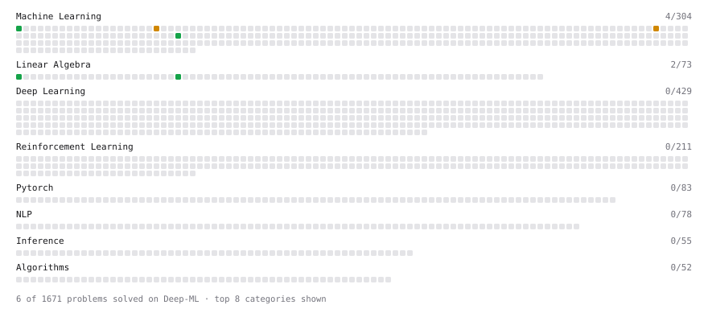

# Deep-ML

My machine learning practice from [Deep-ML](https://www.deep-ml.com). Every solution here was written by hand.

**13** solved · 6 problems · 0 labs · 7 math

[**Browse the interactive portfolio**](https://raghulchandramouli.github.io/deep-ml/) to replay this filling in over time.

## Problems

| | Difficulty | Solved | |
| --- | --- | --- | --- |
| [Compute TTFT ITL and TPS from a Token Timestamp Stream](https://www.deep-ml.com/problems/411) | easy | 2026-10-12 | [solution](problems/0411-compute-ttft-itl-and-tps-from-a-token-timestamp-stream) |
| [Implement Orthogonal Projection of a Vector onto a Line](https://www.deep-ml.com/problems/66) | easy | 2026-10-26 | [solution](problems/0066-implement-orthogonal-projection-of-a-vector-onto-a-line) |
| [Linear Regression Using Normal Equation](https://www.deep-ml.com/problems/14) | easy | 2026-10-26 | [solution](problems/0014-linear-regression-using-normal-equation) |
| [Matrix-Vector Dot Product](https://www.deep-ml.com/problems/1) | easy | 2026-10-24 | [solution](problems/0001-matrix-vector-dot-product) |
| [Implement Gradient Descent Variants with MSE Loss](https://www.deep-ml.com/problems/47) | medium | 2026-10-26 | [solution](problems/0047-implement-gradient-descent-variants-with-mse-loss) |
| [Numerical Gradient Checking](https://www.deep-ml.com/problems/313) | medium | 2026-10-26 | [solution](problems/0313-numerical-gradient-checking) |

## Math

| | Difficulty | Solved | |
| --- | --- | --- | --- |
| [Gradient Descent Updates](https://www.deep-ml.com/math-problems/5) | easy | 2026-10-26 | [solution](math/0005-gradient-descent-updates) |
| [Inverse and Rank](https://www.deep-ml.com/math-problems/12) | medium | 2026-10-24 | [solution](math/0012-inverse-and-rank) |
| [Least Squares and the Normal Equations](https://www.deep-ml.com/math-problems/34) | medium | 2026-10-26 | [solution](math/0034-least-squares-and-the-normal-equations) |
| [Matrix Multiplication](https://www.deep-ml.com/math-problems/10) | medium | 2026-10-24 | [solution](math/0010-matrix-multiplication) |
| [Orthogonality and Projections](https://www.deep-ml.com/math-problems/14) | medium | 2026-10-25 | [solution](math/0014-orthogonality-and-projections) |
| [Policy Gradient Theorem and REINFORCE](https://www.deep-ml.com/math-problems/58) | medium | 2026-10-27 | [solution](math/0058-policy-gradient-theorem-and-reinforce) |
| [Uniform Quantization: Scale and Zero-Point](https://www.deep-ml.com/math-problems/45) | medium | 2026-10-12 | [solution](math/0045-uniform-quantization-scale-and-zero-point) |

---

_This file is regenerated by Deep-ML on every push._
